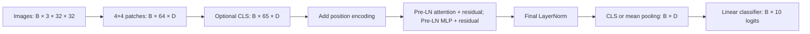

# Vision Transformer from scratch in PyTorch

An educational implementation with explicit patch projections, position encodings,
multi-head attention and pre-normalized transformer blocks. `src/models/` never
imports timm, `nn.MultiheadAttention`, or fused scaled-dot-product attention.
The reference libraries are used for independent correctness checks only.

**Status:** model correctness and CPU infrastructure checks pass. Full CIFAR
training, GPU mixed-precision validation, multi-seed comparisons and trained-weight
publication remain unrun. This repository does not claim benchmark accuracy.
See [the validation record](reports/VALIDATION.md) and [phase status](docs/PHASES.md).

## Image to logits



- **Patch embeddings:** stride-P Conv2d or explicit `unfold` + Linear. Both use
  channel/row/column ordering inside patches; copied weights match outputs and gradients.
- **Positions:** learned 1D, fixed sinusoidal 1D, fixed row/column 2D sin-cos,
  or none. Fixed encodings are buffers. The 2D CLS encoding is zero because CLS
  has no spatial coordinate. The 2D variant requires D divisible by four.
- **Attention:** project to Q/K/V, reshape `[B,N,3D]` into `[3,B,H,N,D/H]`,
  compute `softmax(Q Kᵀ / sqrt(D/H))`, multiply by V, merge heads and project.
  Softmax runs over key tokens. Returned probabilities are before dropout.
- **Blocks:** LayerNorm acts on each token's D channels, leaving B/N alone.
  Attention and the GELU MLP preserve `[B,N,D]`, enabling residual additions.
  DropPath drops a whole sample's branch, not individual token coordinates.
- **Pooling:** CLS selects one token; average pooling uses every normalized patch
  token without introducing an unused CLS parameter. Final head outputs logits.

The [component notebook](notebooks/01_components_walkthrough.ipynb) prints every
intermediate shape and explains each operation. All reusable logic is in `src`.

## Local CPU setup (Python 3.10+)

Linux/macOS terminal commands:

```bash
git clone https://github.com/GaurikMehrotra/-Vision-Transformer-From-Scratch.git vit-from-scratch
cd vit-from-scratch
python3 -m venv .venv
source .venv/bin/activate
python -m pip install --index-url https://download.pytorch.org/whl/cpu torch==2.6.0 torchvision==0.21.0
python -m pip install -r requirements.txt
python -m pip install -e . --no-deps --no-build-isolation
make lint
make test
python -m src.profile --config configs/debug_cpu.yaml --compare-timm
```

On Windows use `py -m venv .venv` and `.venv\Scripts\Activate.ps1`, then run the
same Python commands; substitute `python -m pytest -q` / `python -m ruff check src tests`
if Make is unavailable. In VS Code select this environment as the Python interpreter
and notebook kernel. `ipykernel` is included; the VS Code Jupyter extension renders notebooks.

In the prepared Codex cloud environment, use
`source /workspace/venvs/vit/bin/activate` and the existing checkout instead of cloning.
No separate Git worktree is needed.

## Correctness before training

```bash
python -m pytest -q                         # includes overfit and resume
python -m pytest -q -m "not slow"           # the CPU CI subset
```

Tests cover component shapes, fixed position values, Conv/unfold output and
input/weight gradients, PyTorch MHA outputs/weights/input gradients,
timm ViT logits (`atol=1e-5, rtol=1e-4`), parameter and counted-FLOP equality,
finite gradients for every parameter, single-batch cross entropy below 0.01,
seeded initialization/dropout, disjoint stratified splits, augmentation label
accounting, deterministic workers, atomic checkpoints, exact CPU epoch-boundary
resume and visualization artifacts. Timings/counts are recorded separately.

The no-position timm comparison uses a zero **buffer** in place of its positional
parameter because timm 1.0.15 otherwise skips CLS insertion. Learned-position
comparisons use its standard unmodified model. The implementation itself always
handles CLS independently from position encoding.

## CPU smoke and tiny CIFAR debugging

```bash
python -m src.train --config configs/smoke_synthetic.yaml
python -m src.evaluate --checkpoint runs/smoke_synthetic/best.pt --output runs/smoke_synthetic/validation.json
python -m src.visualize --checkpoint runs/smoke_synthetic/best.pt --output reports/generated/smoke_figures
python -m src.data.preview --config configs/smoke_synthetic.yaml
```

Expect two epochs, finite losses and artifacts. Synthetic accuracy is meaningless;
these commands exercise the workflow without a dataset download. Reuse a directory
only with `--resume`, or choose a fresh `--output`.

Actual CIFAR debug (500 training images, 200 held-out validation images, 64 channels,
2 blocks, 4 heads, batch 32, no workers, 2 epochs):

```bash
python -m src.train --config configs/debug_cpu.yaml
python -m src.data.preview --config configs/debug_cpu.yaml
```

Torchvision downloads the official archive and checks its MD5. Enable access to
`www.cs.toronto.edu` and any official redirect destination if the download is
blocked; keep TLS and checksum validation enabled. An already extracted dataset
can be placed in the configured `data.root` and used with `download: false`.
The cloud validation attempt received a proxy 403, so no actual CIFAR CPU run is
claimed. Training creates no test loader.

## Training, validation and resume

AdamW excludes biases, normalization parameters, CLS and positional tokens from
weight decay. Linear learning-rate warmup precedes cosine decay. Label smoothing,
gradient clipping, CUDA-only autocast/scaling, spatial crop/flip/RandAugment,
from-scratch Mixup/CutMix and stochastic depth are configurable.

A fixed stratified validation split comes from the training set. Best checkpoints
are selected by validation accuracy; official test evaluation requires a separate
explicit flag. Every run saves its fully resolved YAML, split indices/fingerprint,
code/runtime metadata, JSON/CSV metrics, TensorBoard events, `best.pt` and an
atomically replaced `last.pt` every epoch. `best.pt` stores inference weights and selection metadata; `last.pt` stores
optimizer/scaler/RNG state and best-so-far weights for portable resume. Storage stays bounded rather than keeping every historic checkpoint.

```bash
python -m src.train --config configs/debug_cpu.yaml --output runs/debug_interrupted --stop-after-epoch 1
python -m src.train --config configs/debug_cpu.yaml --output runs/debug_interrupted --resume runs/debug_interrupted/last.pt
```

Keep the original config/epoch budget on resume. Exact resume is tested on the
same CPU stack at epoch boundaries, not across GPU types or mid-epoch. Only load
trusted checkpoints: the RNG/optimizer format requires pickle.

## GPU experiments and results

[Exact Kaggle notebook cells](docs/KAGGLE.md) cover cloning, paired CUDA installation,
correctness gates, first-epoch testing, resume, three-seed ViT/ResNet experiments,
ablations, CIFAR-100, final test reporting, visualization and downloading artifacts.
The same Python source runs on CPU/CUDA using automatic device selection.
There are no hardcoded `.cuda()` calls.

Plan without spending GPU time:

```bash
python -m src.experiments --configs configs/vit_tiny_cifar10.yaml configs/resnet_cifar10.yaml --seeds 42 43 44
python -m src.experiments --configs configs/ablations/patch8.yaml configs/ablations/pos_none.yaml --seeds 42
```

Add `--run` only in a GPU runtime after inspecting the plan and available budget.
A one-seed ablation is exploratory. Headline configurations require at least three
completed real-data seeds and mean ± sample standard deviation. Compare the small
ResNet under the same epochs, optimizer, split and augmentation; report the
parameter/FLOP/runtime differences too. Small-data ViTs often underperform CNNs
because they have weaker locality/translation inductive biases. That expectation
has **not** been measured in this project yet.

| Experiment | Completed full-data seeds | Final test mean ± std |
|---|---:|---|
| ViT CIFAR-10 | 0 | Not measured |
| ResNet CIFAR-10 | 0 | Not measured |
| Ablations | 0 | Not measured |
| ViT CIFAR-100 (optional) | 0 | Not measured |

```bash
python -m src.results --root runs/experiments --output reports/generated/validation
# Only after freezing model/config selection:
python -m src.evaluate --checkpoint runs/experiments/vit_tiny_cifar10/seed42/best.pt --split test --final-test --output runs/experiments/vit_tiny_cifar10/seed42/test.json
python -m src.results --root runs/experiments --metric test --output reports/generated/final_test
```

The aggregator excludes incomplete/synthetic runs by default, rejects duplicate
seeds/config mismatch/data split mismatch, distinguishes validation from test,
and labels results with fewer than three seeds as diagnostic. Data/weights/logs
are ignored by Git. Generated experiment outputs default to `reports/generated/`.

## Parameters, FLOPs and interpretation

Measured debug model: **108,106 parameters**, **7,772,608 counted FLOPs per image**;
the equivalent timm reference matches both. One multiply-add counts as one FLOP.
Softmax, GELU and elementwise operations omitted by fvcore are explicitly listed
in [the profile](reports/profile_debug_cpu.json); this is not a complete hardware
cost model. Run `src.profile` on the actual experiment config before reporting it.

```bash
python -m src.profile --config configs/vit_tiny_cifar10.yaml --compare-timm --output reports/generated/profile_full.json
python -m src.visualize --checkpoint runs/experiments/vit_tiny_cifar10/seed42/best.pt --index 0 --output reports/generated/figures
```

The visualization command exports every layer/head's maps, raw attention arrays,
rollout and overlay, learned-position cosine similarity and RGB patch filters,
plus provenance and interpretation notes. For GAP it averages patch queries;
CLS uses the CLS query. Attention/rollout are routing heuristics, not causal
attribution. Real-trained figures and an empirical analysis are pending; no
synthetic figures are presented as trained semantic explanations.

## Repository and completion checklist

`src/models/`: seven component files. `src/data/`: CIFAR/synthetic loaders,
augmentation and preview. `src/baselines/`: ResNet-20. Other `src/` modules:
training/evaluation, profile, visualization, experiments, results and utilities.
`tests/`: correctness and infrastructure checks. `configs/`: CPU/GPU/ablation
YAMLs. `notebooks/`: components, attention and results. `docs/`: phase commands,
Kaggle execution, publishing. `reports/`: measured validation and profile records.

Before a **trained-model** release: apply dataset network access; validate a CUDA
first epoch/resume; run real CIFAR debug; complete the matched baseline and
three-seed experiments; freeze selections; run final test evaluations; write
actual ablation/figure findings; update README/model card; publish weights with
checksums. No unfinished experiment is called completed.

See [MODEL_CARD.md](MODEL_CARD.md) for intended use/limitations and
[release commands](docs/RELEASE.md) for `git push`, optional `gh repo create`, and
GitHub Release assets. Code is MIT licensed; third-party datasets have their own terms.
